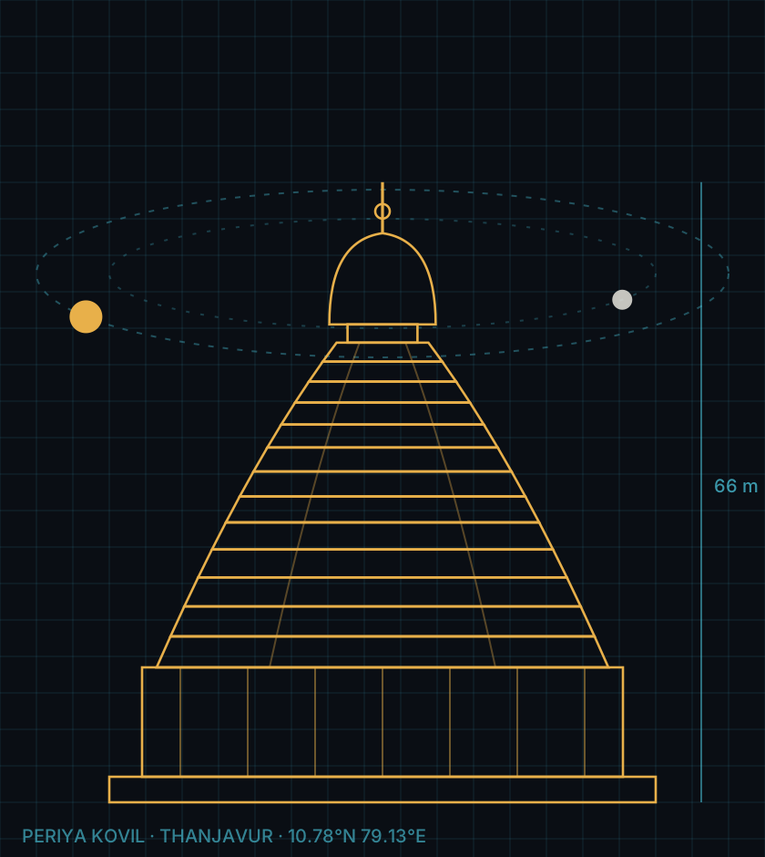
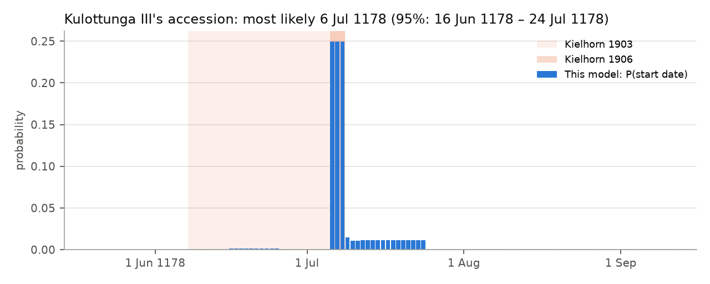

<p align="center"></p>

<h1 align="center">chola-dates</h1>

<p align="center">
<b>Dating the medieval Chola kings from the sky, and catching the stone carvers' mistakes.</b><br>
<a href="https://chola-dates.streamlit.app"><b>▶ Try the live app</b></a>
</p>

---

Temple inscriptions from medieval South India (c. 850–1280 CE) never give a year. They describe the sky instead:

> *"In the 14th year of … Kulottunga-Chola … on a day which was Thursday, the day of Pushya, and the first tithi of
> the first fortnight of the month of Makara."* (Somangalam; *Epigraphia Indica* VII, No. 60)

That is a regnal year plus four astronomical clues: the sun's month, the moon's phase (*tithi*), the moon's star group
(*nakshatra*) and the weekday. Around 1900, the scholar Franz Kielhorn solved hundreds of these by hand and used them to
fix when each king came to the throne. Many inscriptions were carved with mistakes.

This project rebuilds that work computationally, for one king, Kulottunga III:

1. **Solver**: recomputes the sky over Thanjavur for any day and finds every day matching an inscription's clues.
2. **Dataset**: all 24 Kulottunga III inscriptions Kielhorn examined, machine-readable, clues exactly as carved.
3. **Detective**: a Bayesian model that estimates the accession date with uncertainty, *while* working out which
   inscriptions were miscarved and how.

## Results

- **Kulottunga III most likely came to the throne on 6 July 1178** (50% credible interval 6–8 July; 95% interval
  16 June – 24 July 1178). This independently reproduces Kielhorn's final conclusion (*EI* VIII, 1906: "about 6–8 July 1178").
- The solver reproduces **all 14** dates Kielhorn judged correct; each is the only matching day in its regnal year.
- The model flags as miscarved **exactly** the five inscriptions whose errors Kielhorn diagnosed by hand, and names the
  same error each time: two swapped fortnights, a wrong nakshatra, a 4 carved for a 14, and a 15 for a 25 together with
  an off-by-one regnal year. About **1 carved clue in 11** is wrong.
- **New: four of Kielhorn's nine "errors" are probably not errors.** In Nos. 108, 109, 113 and 114 the carved tithi is
  one ahead of the tithi at sunrise, and in every case that tithi began later the same day. Read as "the tithi current
  at the time", they fit perfectly, and the data are **~10^6.4 (about 2.5 million) times** more probable than under the
  sunrise rule. Under Kielhorn's rule the model only narrows the accession to 8 June – 8 July 1178, his own earlier (1903)
  window.

<p align="center"></p>
<p align="center"></p>

## How it works

**The solver.** For each day, the Swiss Ephemeris (`pyswisseph`) gives the sidereal longitudes of the sun and moon at
sunrise over Thanjavur. From those:

| Clue | Computed as |
|---|---|
| Solar month and day | the sun's sidereal sign at sunset, and days since it entered it |
| Tithi and paksha | the moon's lead over the sun in 12° steps (30 per lunar month; 1–15 bright, 16–30 dark) |
| Nakshatra | the moon's sidereal longitude in 27 equal steps of 13°20′ |
| Weekday | from the Julian Day Number |

Dates before 1582 are Julian. An Indian day runs sunrise to sunrise, so the solver records each tithi and nakshatra in
force at sunrise *and* every one current during the day.

**Calibration.** Kielhorn computed with the traditional *Surya-siddhanta*, not modern astronomy. Five sankranti times he
publishes for 1193–1225 imply our sidereal frame should sit **1.69° ± 0.14°** from modern Lahiri
([`scripts/calibrate.py`](scripts/calibrate.py)). With that, his 20 published solar-day numbers are matched exactly in
15 cases and within one day in all 20, so a stated solar day is accepted ±1.

**The detective.** For every candidate accession day *A* (1174–1182, uniform prior) and per-clue error rate *ε*:
an inscription's true date is some day of its regnal year; each clue is carved correctly with probability 1 − *ε*, and
wrong values follow an error model (the other fortnight, a neighbouring tithi or nakshatra, a slipped 10 in a day
number); the regnal year itself is off by one with probability 5%. Multiplying over inscriptions gives
P(*A*, *ε* | inscriptions). The same quantities give each inscription's probability of being miscarved and its most
likely true date. A simpler "votes" method (how many inscriptions each *A* explains with zero errors) peaks at
**18 of 24 on 6–8 July 1178**.

**Robustness.** The answer barely moves when the assumptions change:

| Assumption | Most likely | 50% interval | Flagged as miscarved |
|---|---|---|---|
| Main model | 6 Jul 1178 | 6–8 Jul | 16, 24, 31, 60, 90, 111 |
| Every wrong value equally likely | 6 Jul | 6–7 Jul | same |
| Regnal-year error 2% / 10% | 7 Jul / 6 Jul | 6–7 Jul / 6–8 Jul | same |
| Kielhorn's practice (tithi at sunrise) | 17 Jun | 11–26 Jun | + 93, 108, 109, 113, 114 (Bayes factor 10^−6.4) |

**Checks.** Weekdays of 38/38 dated Chola inscriptions in Kielhorn's summary list (*EI* VII pp. 6–8); a modern tithi
boundary matched to a published panchang to the minute; 53 automated tests, including the app.

## The app

[chola-dates.streamlit.app](https://chola-dates.streamlit.app), or run it locally (below). Written for someone who has
never heard of any of this:

- **The story**: a six-step walk through inscription No. 60, from the stone to the king.
- **Try it**: decode any of the 24 inscriptions, or your own clues; see which clue would be the mistake.
- **The verdict**: the accession date, the evidence, and every inscription's probability of being miscarved.
- **Map**: the 18 temple sites, stepped through the reign year by year.
- **Sky**: the sun, moon, tithi and nakshatra over Thanjavur on any morning from 1170 to 1230.

## Repository

```
chola/              the library
  astro.py            dates, sun and moon positions, sunrise (Swiss Ephemeris)
  panchang.py         tithi, nakshatra, solar month and day for each day
  search.py           the solver: clues -> matching days
  dataset.py          loading the inscriptions
  detective.py        votes and the Bayesian accession model
data/
  kulottunga3.csv     the dataset: 24 inscriptions, clues as carved, Kielhorn's date and verdict
  places.csv          approximate site coordinates
scripts/
  calibrate.py        star-frame calibration from Kielhorn's sankranti times
  validate.py         solver vs Kielhorn -> results/validation.md
  detective.py        accession model, robustness, charts -> results/detective.md
streamlit_app.py    the app (with app/visuals.py)
tests/              53 tests
examples/no60.py    the worked example
```

## Run it

```bash
python3 -m venv .venv && source .venv/bin/activate
pip install -r requirements.txt
pytest                         # 53 tests
python scripts/validate.py     # dataset vs Kielhorn
python scripts/detective.py    # accession model, charts, robustness (~30 s)
streamlit run streamlit_app.py # the app
```

## Limitations

- One king. Kielhorn's corpus for Kulottunga III is 24 dated inscriptions, not hundreds.
- Data extracted from OCR'd transcriptions of Kielhorn; each row is cross-checked by the solver, but readings of damaged
  originals are his (or his sources').
- Only the equal-space nakshatra system; Kielhorn's Garga and Brahma-siddhanta variants are not yet implemented.
- Our sun is modern; a full Surya-siddhanta sun model would remove the ±1 solar-day tolerance.
- The error-model weights are stated assumptions, not estimates; the robustness table shows the result does not hinge
  on them. Inscriptions are treated as independent (Nos. 108 and 109 record the same date).
- Site coordinates are approximate (village level).

## Next steps

- Cross-check medieval dates against Yano and Fushimi's independent *Pancanga* program.
- Implement a Surya-siddhanta sun and the Garga / Brahma-siddhanta nakshatra systems.
- Extend to every Chola king in Kielhorn's lists, then to the wider corpus, and model overlapping reigns and co-regencies.
- Use the dated inscriptions as a time series for economic history: land grants, prices and temple endowments by year.

## Sources and credits

- F. Kielhorn, "Dates of Chola Kings", *Epigraphia Indica* IV (1896–97), V, VI (1900–01), VII (1902–03), VIII (1905–06);
  transcriptions at whatisindia.com and jainqq.org.
- Swiss Ephemeris (Astrodienst), via `pyswisseph`; AGPL-3.0, hence this repository's licence.
- Built by [Sanjay Ashok](https://github.com/sanjayashokbuilds) as a 24-hour build, with Claude (Anthropic) as
  pair programmer.
