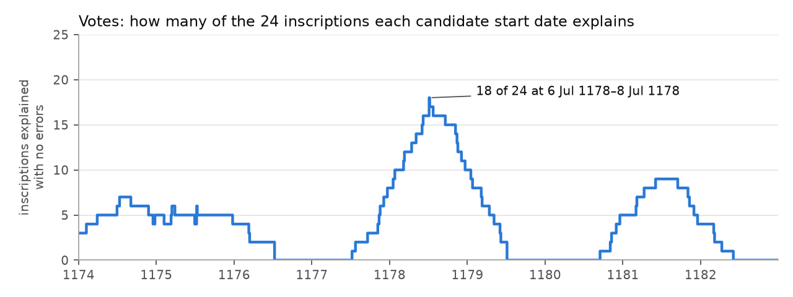
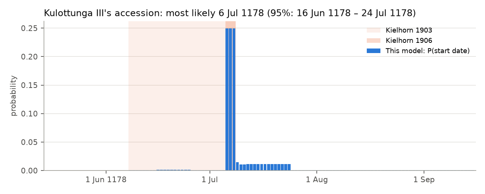
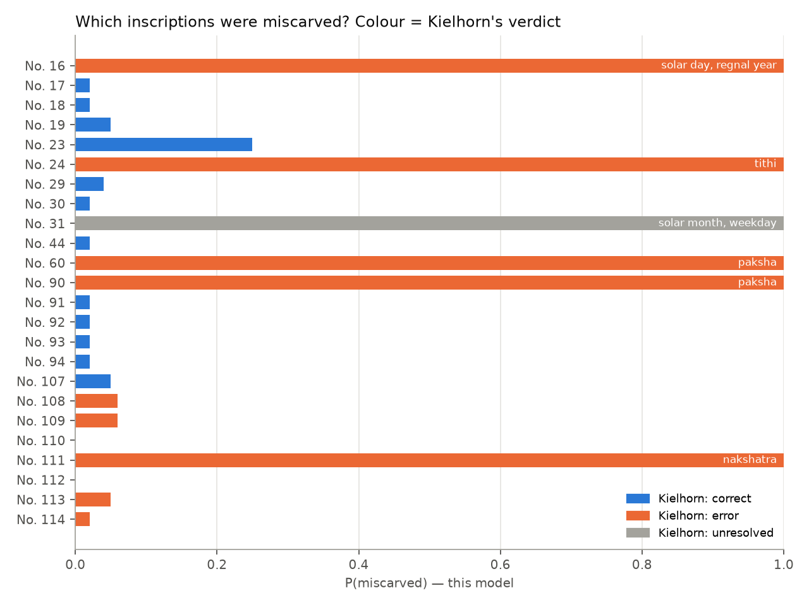

# chola-dates

Re-dating medieval Chola kings from the astronomical clues carved into their
temple inscriptions, with an explicit model of scribal errors.

> Status: **work in progress** (24-hour build, Oct 2026). Solver, dataset, validation
> and the accession model are done; demo app next.

## Headline results

- **Accession of Kulottunga III: most likely 6 July 1178** (50% credible interval
  6–8 July; 95% interval 16 June – 24 July 1178), independently reproducing Kielhorn's
  final conclusion (*EI* VIII, 1906: about 6–8 July 1178).
- The model flags as miscarved **exactly** the five inscriptions whose errors Kielhorn
  diagnosed by hand, and names the same error in every case (wrong fortnight ×2, wrong
  nakshatra, a 4 for a 14, a 15 for a 25 plus an off-by-one regnal year).
- **Four of Kielhorn's nine "errors" are probably not errors.** Read as naming the tithi
  current *later in the day* rather than at sunrise, they fit perfectly, and the data are
  ~10^6.4 times more probable under that reading than under Kielhorn's sunrise rule.
  Under his rule the model only narrows the accession to 8 June – 8 July 1178, his
  earlier (1903) window; his final 6–8 July answer follows naturally from the
  during-day reading.

## The problem

Chola inscriptions (c. 850–1280 CE) don't give calendar dates. They say things like
*"in the 14th year of king Kulottunga, on a Thursday, the day of the nakshatra Pushya,
the first tithi of the first fortnight of the month of Makara."* Around 1900,
F. Kielhorn solved hundreds of these by hand (*Epigraphia Indica*, vols IV–VIII) and used
them to fix when each king began to reign. Many carvings contain mistakes.

This project rebuilds that work computationally:

1. **Solver**: turns an inscription's clues into every matching day.
2. **Dataset**: every Kulottunga III date Kielhorn examined, machine-readable.
3. **Detective**: estimates the accession date with uncertainty, while
   working out which inscriptions are probably miscarved and how.

## The solver

For any day it computes, at Thanjavur:

| Clue | How |
|---|---|
| Weekday | from the Julian Day Number |
| Solar month and day | the sun's sidereal sign at sunset, and days since it entered it |
| Tithi and paksha | the moon's lead over the sun, in 12° steps |
| Nakshatra | the moon's sidereal position, in 27 steps of 13°20′ |

Positions come from the Swiss Ephemeris (`pyswisseph`). Dates before 1582 are Julian.
An Indian day runs from sunrise to sunrise; the solver records the tithi and nakshatra
at sunrise *and* every one current during the day, so both readings can be tested.

**Calibration.** Kielhorn computed with the traditional *Surya-siddhanta*, not modern
astronomy. Five sankranti times he publishes for 1193–1225 imply our sidereal frame should
sit **1.69° ± 0.14°** from modern Lahiri (`scripts/calibrate.py`). With that, his 20
published solar-day numbers are reproduced exactly in 15 cases and within one day in all 20;
the remaining differences come from the traditional sun model's different equation of
centre, so a stated solar day is accepted ±1.

## The dataset

[`data/kulottunga3.csv`](data/kulottunga3.csv): **24 dated inscriptions of Kulottunga III**
(r. 1178–1218) from Kielhorn's "Dates of Chola Kings" in *EI* IV, V, VI, VII and VIII. For
each: place, regnal year, every astronomical clue *as carved*, Kielhorn's computed date and
his verdict (correct, or which detail he judged wrong).

## Validation against Kielhorn

`python scripts/validate.py` → [`results/validation.md`](results/validation.md)

| | |
|---|---|
| Dates Kielhorn calls **correct** | 14 |
| ... all clues hold on his day, and it is the **only** matching day in that regnal year | **14 / 14** |
| Dates Kielhorn calls **erroneous** | 9 |
| ... clues genuinely fail on his day (wrong fortnight ×2, nakshatra, tithi 4-for-14, solar day 15-for-25) | 5 |
| ... **all clues hold** if the tithi current *later in the day* is meant | **4** (Nos. 108, 109, 113, 114) |

**Finding.** Kielhorn marks Nos. 108/109, 113 and 114 as "wrong tithi" (12 for 11, 5 for 4,
9 for 8). In each case the carved tithi is the *next* one, which began during that same
day. That is a consistent pattern, more like a recording convention (the tithi current at
the time of the event) than random carving errors. The detective will weigh both readings.

Also checked: weekdays of **38/38** dated Chola inscriptions in Kielhorn's summary list
(*EI* VII pp. 6–8), and a modern tithi boundary against a published panchang (to the minute).

## The detective

`python scripts/detective.py` → [`results/detective.md`](results/detective.md)

**1. Votes.** For every candidate start date between 1174 and 1182, count how many
inscriptions have a day matching *all* their clues inside the regnal year that start date
implies. With no carving errors the true date would explain all 24; the best dates
explain **18 of 24**, in a single run: **6–8 July 1178**.



**2. Bayesian model.** For each candidate start date *A* and per-clue error rate *ε*:

- the inscription's true date is some day of its regnal year (all equally likely);
- each clue was carved correctly with probability 1 − *ε*; if wrong, the wrong value
  follows an error model (other fortnight, neighbouring tithi/nakshatra, a slipped 10 in a
  day number, …);
- the regnal year itself is off by one with probability 5%.

Multiplying over inscriptions gives P(*A*, *ε* | inscriptions). The same quantities give
each inscription's probability of being miscarved and its most likely true date.
The data estimate *ε* ≈ 0.09: about 1 carved clue in 11 is wrong.





No. 23 sits at 0.25 because its date (8 July 1185, year 8) is what caps the accession at
8 July: start dates later than that need its regnal year to be wrong. No. 31, which
Kielhorn left unresolved, needs at least two errors under any reading; the model offers
June 1198 but with low confidence (0.25).

**3. Robustness.** The answer barely moves when the assumptions change:

| Assumption | Most likely | 50% interval | Flagged |
|---|---|---|---|
| Main model | 6 Jul 1178 | 6–8 Jul | 16, 24, 31, 60, 90, 111 |
| Every wrong value equally likely | 6 Jul | 6–7 Jul | same |
| Regnal-year error 2% / 10% | 7 Jul / 6 Jul | 6–7 Jul / 6–8 Jul | same |
| Kielhorn's practice (tithi at sunrise) | 17 Jun | 11–26 Jun | + 93, 108, 109, 113, 114 (Bayes factor 10^−6.4) |

## Worked example: No. 60

`python examples/no60.py`. As carved ("first fortnight"), no day matches. Allowing one
error, two candidates appear: 2 Jan 1192 (fortnight wrong; Kielhorn's answer) and
16 Jan 1192 (nakshatra wrong). Choosing between them is the detective's job.

## Run it

```bash
python3 -m venv .venv && source .venv/bin/activate
pip install -r requirements.txt
pytest                         # 52 tests
python scripts/validate.py     # dataset vs Kielhorn
python scripts/calibrate.py    # frame calibration
python scripts/detective.py    # accession model, charts, robustness (~30 s)
```

## Limitations (so far)

- One king. Kielhorn's own corpus for Kulottunga III is ~24 dates, not hundreds.
- Data extracted from OCR'd transcriptions of Kielhorn; each row is cross-checked by
  the solver, but readings of damaged originals are his (or his sources').
- Only the equal-space nakshatra system; Garga and Brahma-siddhanta are not yet implemented.
- Our sun is modern; a full Surya-siddhanta sun would remove the ±1 solar-day tolerance.
- The error-model weights (e.g. 30% of wrong tithis are a swapped fortnight) are stated
  assumptions, not estimates; the robustness table shows the result doesn't depend on them.
- Uniform prior over 1174–1182; inscriptions treated as independent (Nos. 108 and 109
  record the same date and so count twice).

## Sources

- F. Kielhorn, "Dates of Chola Kings", *Epigraphia Indica* IV (1896–97), V, VI (1900–01),
  VII (1902–03), VIII (1905–06); transcriptions at whatisindia.com and jainqq.org
- Swiss Ephemeris (Astrodienst), via `pyswisseph`; AGPL-3.0, hence this repository's licence
